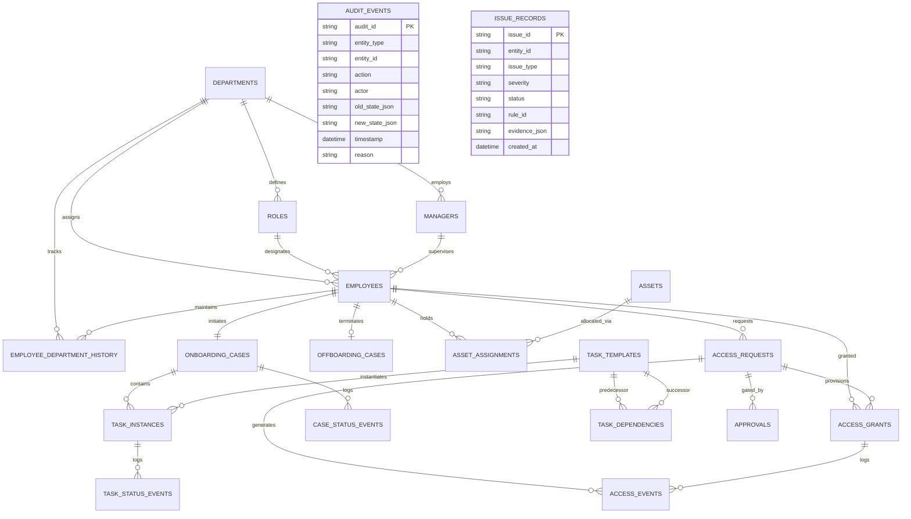

# YottaFlex Database Schema & Entity-Relationship Architecture

This document explains the relational database architecture, entity cardinalities, constraints, indexing strategies, and transactional semantics for the YottaFlex Employee Lifecycle Orchestrator.

---

## 1. Entity-Relationship Diagram (Mermaid)

---

## 2. Relational Cardinalities & Relationships

1. **Departments to Roles & Employees (1:N)**:
   - A Department defines multiple Roles and contains multiple active Employees.
   - Deleting a department is restricted when active employees exist.
2. **Managers to Employees (1:N, Nullable)**:
   - A Manager supervises multiple Employees.
   - `manager_id` is foreign keyed to `managers.manager_id` with `nullable=True` to explicitly support testing of the Missing Manager anomaly (#2) without corrupting foreign key integrity.
3. **Employees to OnboardingCases (1:1)**:
   - Every hired employee receives exactly one onboarding case record (`ONB-2026-XXXXXX`).
4. **OnboardingCases to TaskInstances (1:N, Strict 1:8)**:
   - Exactly 8 task instances are generated per onboarding case based on the standard role-agnostic foundation templates:
     1. TPL-001: Verify Identity & I-9 Documents (HR)
     2. TPL-002: Background Check Screening (HR)
     3. TPL-003: Create Corporate Email & SSO Identity (IT)
     4. TPL-004: Provision Core Hardware & Peripherals (FACILITIES)
     5. TPL-005: Request Role-Specific System Access (IT)
     6. TPL-006: Manager 1-on-1 & Team Introduction (MANAGER)
     7. TPL-007: Security Compliance & Data Privacy Training (SECURITY)
     8. TPL-008: Final Onboarding Clearance & Sign-Off (HR)
   - 500 cases × 8 task instances = **4,000 onboarding task instances**.
5. **Task Dependencies (DAG, N:M via Bridge Table `task_dependencies`)**:
   - `task_dependencies` acts as an explicit bridge table defining prerequisite edges between `predecessor_template_id` and `successor_template_id`.
   - Topological sort verifies that the dependency graph is acyclic.
6. **Assets to AssetAssignments (1:N, Temporal)**:
   - An Asset can have multiple historical assignments, but **at most one active assignment** at any given moment.
   - The presence of two active assignments with overlapping validity intervals represents Anomaly #3.
7. **AccessRequests to Approvals & Grants (1:N and 1:1)**:
   - Two-phase authorization model: Access cannot transition to `PROVISIONED` or create an `AccessGrant` without an associated `Approval` record in `APPROVED` status.
8. **Employees to OffboardingCases (1:1 optional)**:
   - Generated when an employee status transitions to `TERMINATED`. Tracks revocation of all active access grants and recovery of all assigned hardware.
9. **Employees to Department History (1:N)**:
   - Effective-dated SCD Type 2 table tracking inter-departmental transfers.

---

## 3. Constraints, Indexes & Transactional Integrity

### 3.1 Primary & Foreign Keys
- Every table has an explicit single-column Primary Key (`VARCHAR(32)` or `VARCHAR(64)`).
- All foreign keys specify `nullable=False` except `employees.manager_id` (Anomaly #2 support) and `task_status_events.old_status` (initial creation).

### 3.2 Indexes
- `audit_events`: Composite index on `(entity_type, entity_id)` for sub-millisecond audit trail queries by entity.
- `audit_events`: Index on `(timestamp)` for chronological timeline rendering.
- `employees`: Unique index on `email`.
- `assets`: Unique index on `asset_tag` and `serial_number`.
- `departments`: Unique index on `name` and `code`.
- `task_dependencies`: Unique constraint on `(predecessor_template_id, successor_template_id)`.

### 3.3 Transactional Writes
- All state-altering operations (Task completion, Access provisioning, Offboarding initiation, Asset recovery) execute within atomic SQLAlchemy transactions.
- Audit records (`AuditEvent`, `TaskStatusEvent`, `CaseStatusEvent`, `AccessEvent`) are committed in the same transaction as the parent entity mutation to ensure 100% audit durability with zero ghost updates.
